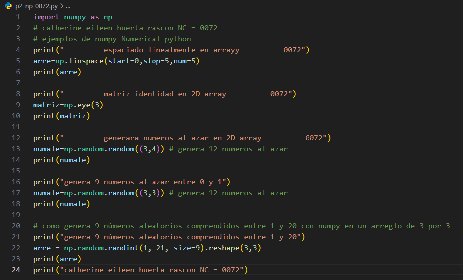
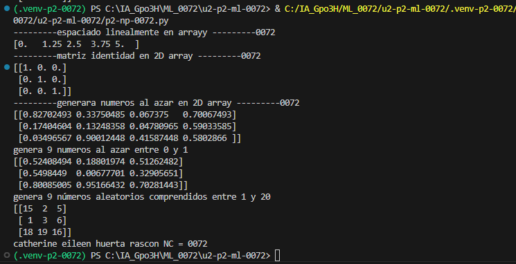

start=0: Define el valor inicial del intervalo. El primer elemento de la secuencia generada será exactamente 0.

stop=1: Define el valor final del intervalo. Por defecto, este punto final está incluido en la secuencia, por lo que el último elemento será exactamente 1.

num=5: Especifica la cantidad de valores que se van a generar en total dentro del rango definido (desde start hasta stop), repartidos en partes iguales. En este caso, generará exactamente 5 números (0., 0.25, 0.5, 0.75 y 1.).

## que es linspace
linspace (abreviatura de linear space o espacio lineal) es una función de la librería NumPy en Python que se utiliza para generar un arreglo de números espaciados uniformemente a lo largo de un intervalo determinado.

## el codigo

## resultado
